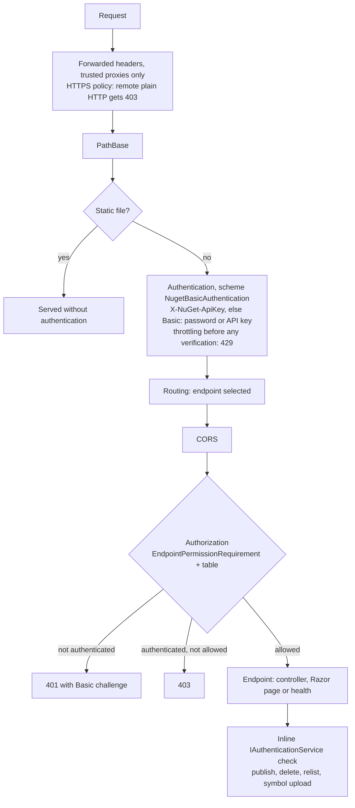

# 0002. Authentication and authorization architecture

- Status: Accepted
- Date: 2026-11-12
- Issues: #6 (this record); implemented by #11, #12, #15–#35; verified by #30
  and #37–#39

This ADR records how ElPaqueto replaces the authentication and authorization
inherited from BaGetter. It settles the design shared by the issues listed
above, so that each of them implements one part of one design instead of
re-deciding it.

## Context

### What the inherited code does

- **Basic handler.** `src/ElPaqueto.Web/Authentication/NugetBasicAuthenticationHandler.cs`
  returns an *authenticated* principal with an `Anonymous` claim when no
  credentials are configured, so every `[Authorize]` passes. It compares
  plaintext passwords from configuration with `==`, matches usernames
  case-insensitively and never checks that the scheme is `Basic`. It challenges
  with `realm="NuGet Server"`.
- **API keys.** `src/ElPaqueto.Core/Authentication/ApiKeyAuthenticationService.cs`
  returns `true` when no key is configured, compares plaintext keys with
  `==`/`Equals`, and does not tie keys to users.
- **Registration.** `Startup.ConfigureElPaquetoApplication`
  (`src/ElPaqueto/Startup.cs`) calls the `internal` methods
  `AddNugetBasicHttpAuthentication` and `AddNugetBasicHttpAuthorization`
  (`src/ElPaqueto/IServiceCollectionExtensions.cs`). They register the handler
  as default authenticate and challenge scheme under the name
  `NugetBasicAuthentication`, and the policy `NuGetUserPolicy` as
  `RequireAuthenticatedUser()`. Both names are constants in
  `src/ElPaqueto.Core/Authentication/AuthenticationConstants.cs`.
- **Controllers** (`src/ElPaqueto.Web/Controllers/`).
  - Five controllers carry the class-level attribute
    `[Authorize(AuthenticationSchemes = NugetBasicAuthentication, Policy = NuGetUserPolicy)]`:
    `ServiceIndexController`, `SearchController`, `PackageMetadataController`,
    `PackageContentController`, `SymbolController`.
  - `PackagePublishController` has no authorization metadata. Its `Upload`,
    `Delete` and `Relist` actions call `IAuthenticationService.AuthenticateAsync`
    inline with the `X-NuGet-ApiKey` header value and return a bare 401
    (no `WWW-Authenticate`) on failure or when `IsReadOnlyMode` is set.
    `SymbolController.Upload` does the same, on top of its class attribute.
- **Razor pages** (`/`, `/packages/{id}/{version?}`, `/upload`, `/stats`) have
  no authorization metadata.
- **Health check.** `app.UseHealthChecks(...)` runs as terminal middleware
  after `UseEndpoints`. It is not an endpoint, so endpoint authorization cannot
  apply to it.
- **Pipeline order** in `Startup.Configure`: `UseForwardedHeaders`,
  `UsePathBase`, `UseStaticFiles`, `UseAuthentication`, `UseRouting`,
  `UseAuthorization`, `UseCors`, `UseOperationCancelledMiddleware`,
  `UseEndpoints`, `UseHealthChecks`.
- **Extension points.**
  - Routes are mapped by conventional routing in
    `src/ElPaqueto.Web/ElPaquetoEndpointBuilder.cs`: `MapRazorPages()` plus 17
    named controller routes whose names are constants in
    `src/ElPaqueto.Web/Routes.cs`.
  - `AddElPaquetoApplication` (`src/ElPaqueto.Core/Extensions/DependencyInjectionExtensions.cs`)
    runs `AddElPaquetoServices` (which registers
    `IAuthenticationService` → `ApiKeyAuthenticationService` with
    `TryAddTransient`) **before** it invokes the `configureAction` in which
    `Startup.ConfigureElPaquetoApplication` runs.
  - `src/ElPaqueto.Security` (#11) references `ElPaqueto.Core` and the ASP.NET
    Core shared framework only, not `ElPaqueto.Web`. Its single entry point
    `AddElPaquetoSecurity` is called from `ConfigureElPaquetoApplication`, and
    it binds the validated `Security` options section (#12).

### Behaviour verified for this ADR

These facts were checked with throwaway tests against the current tree and
ASP.NET Core 10 (not committed). Everything else about ASP.NET Core below is
documented framework behaviour, not re-verified here.

1. Conventionally routed controller endpoints carry `IRouteNameMetadata` with
   the route name from `Routes.cs` (`index`, `upload-package`, …). They carry
   no `IEndpointNameMetadata`.
2. Conventional routing also produces one link-generation endpoint per route
   (display name `Route: <pattern>`). It carries the same route name and
   `SuppressMatchingMetadata`, so it never matches a request.
3. Razor page endpoints carry no route name. Their `PageActionDescriptor` gives
   the page path: `/Index` (two endpoints, `""` and `Index`), `/Package`,
   `/Statistics`, `/Upload`.
4. `IHttpMethodMetadata` exists only on `index` (GET), `registration-index`
   and `registration-leaf` (GET), `delete` (DELETE) and `relist` (POST).
   `upload-package` and `upload-symbol` are restricted by a route constraint
   instead (GET on `api/v2/package` returns 404). All other routes accept any
   method today: `POST /v3/search` returns 200, `HEAD /v3/index.json` returns
   405.
5. `FallbackPolicy` also applies when no endpoint matched and to the 405
   endpoint produced by the matcher. With a deny-all fallback, `GET /health`,
   `GET /does/not/exist` and `POST /v3/index.json` were all refused.
6. With a fallback policy that contains only a custom requirement (no
   `RequireAuthenticatedUser`), the requirement handler alone decides. It can
   let an anonymous request through, even when authentication returned
   `Fail`. When it does not succeed, the result is a challenge (401, from the
   default challenge scheme) for an unauthenticated user and a forbid (403)
   for an authenticated one. This holds for the fallback policy, the default
   policy and a named policy combined with explicit `AuthenticationSchemes`.
7. When an endpoint has two `[Authorize]` entries, the requirement runs once
   per entry (AND semantics). The authentication handler still runs once per
   request, even when `[Authorize]` names the default scheme explicitly.
8. The requirement handler receives the `HttpContext` as resource, and
   `GetEndpoint()` returns the matched endpoint and its metadata.
9. `UseStaticFiles` placed before `UseAuthentication` serves an existing file
   without invoking authentication or authorization.
10. With the inherited handler and no credentials configured,
    `GET /v3/index.json` returns 200 to an anonymous client even under a
    deny-all fallback policy, because the `[Authorize]` attribute takes
    precedence over the fallback and the handler authenticates everyone.

Not verified here: serving of `/_content/ElPaqueto.Web/**` static web assets in
the real host (the test host does not serve them, so the requests fell through
to routing). Point 9 shows the framework behaviour that makes them anonymous.
#24 must assert it on the real host.

## Decision

### 1. Module layout

- All new security code lives in `src/ElPaqueto.Security`: authentication
  handler, authorization requirement and table, stores and `AuthDbContext`,
  CLI commands and options. Tests live in `tests/ElPaqueto.Security.Tests`
  (#11).
- No `.Abstractions` project until a second consumer exists.
- `ElPaqueto.Security` does not reference `ElPaqueto.Web` (enforced by the
  architecture test of #11). The permission table therefore spells the route
  names as string literals. A test that can reference `ElPaqueto.Web` asserts
  that every `Routes` constant has a table row, and that every table row
  matches a real endpoint (#24, #30).
- Host wiring goes through extension methods of this project, called once each
  from the inherited host files (decision 10).

### 2. Separate SQLite authentication database

- `AuthDbContext : DbContext`, not derived from `AbstractContext` and not
  registered as `IContext`. It has its own migrations under
  `src/ElPaqueto.Security/Data/Migrations/` and history table
  `__AuthMigrationsHistory` (#15).
- SQLite only, whatever the package database provider. WAL journal mode and
  an explicit busy timeout, so the server and a CLI process can share the file.
- Location: `Security:Database:ConnectionString` (#12). The default is
  `Data Source=auth.db`; the container image sets `Data Source=/data/db/auth.db`
  (#44).
- No foreign keys across databases. API keys reference users inside this
  database only (#31).
- The server migrates it at startup, before Kestrel accepts requests,
  independently of the inherited `RunMigrationsAtStartup`; failure stops the
  server. CLI commands migrate it explicitly (#15, #20).

Rationale: no new migrations in the four inherited provider migration trees
(SQLite, PostgreSQL, SQL Server, MySQL; MySQL is excluded from the build until
#55), so ported upstream migrations apply cleanly (#13). Authentication does not
depend on the package database provider. The file gets its own backup and
permissions (`0600` on Unix, #15), and user writes do not contend with package
writes for the SQLite writer lock.

### 3. Minimal controller diff: reuse the scheme and policy names

- `AddElPaquetoSecurity` registers the new handler under the existing scheme
  name `NugetBasicAuthentication`, as default authenticate and challenge
  scheme, and defines the existing policy name `NuGetUserPolicy` (#17).
- The five controller attributes stay untouched. Because the attribute names
  the scheme explicitly, a different scheme name would leave those controllers
  on a scheme that no longer exists.
- #17 removes the calls to `AddNugetBasicHttpAuthentication` and
  `AddNugetBasicHttpAuthorization` from `Startup`, and deletes these two
  methods, the inherited handler and its unit tests. The deletions are listed
  in `docs/upstream-porting.md` (#13), so a later upstream change to them fails
  to apply and gets reviewed against the new code.
- No controller, `ElPaquetoEndpointBuilder.cs`, `Routes.cs` or
  `AuthenticationConstants.cs` file is modified by the authentication work.

### 4. Deny by default

- `AuthorizationOptions.FallbackPolicy`, `AuthorizationOptions.DefaultPolicy`
  and `NuGetUserPolicy` are the same policy: one `EndpointPermissionRequirement`
  (decision 5). Every endpoint goes through one of them: the fallback for
  endpoints without metadata (`PackagePublishController`, Razor pages, health,
  anything ported later), `NuGetUserPolicy` for the five annotated controllers,
  the default policy for a bare `[Authorize]`.
- The fallback policy does **not** add `RequireAuthenticatedUser`. The
  requirement itself demands an authenticated principal for every entry except
  the anonymous ones, which is what lets the liveness endpoint stay anonymous
  without `[AllowAnonymous]` (verified behaviour 6).
- Anonymous access exists in exactly two places:
  - static files served by `UseStaticFiles`, which runs before authentication
    and short-circuits (verified behaviour 9); they are not endpoints and never
    reach authorization;
  - table entries marked `Anonymous`. V1 has one: the liveness endpoint
    (decision 9).
- `[AllowAnonymous]` is not used anywhere. The inventory test (#30) fails on any
  endpoint carrying `IAllowAnonymous` metadata.
- A request that matches no endpoint is denied too (verified behaviour 5): 401
  when anonymous, 403 when authenticated. Unknown URLs therefore reveal nothing
  to anonymous callers.

### 5. Route-to-permission mapping

**Chosen: one requirement, one table, evaluated through the policies above.**

`EndpointPermissionRequirement`'s handler:

1. Reads the endpoint from the `HttpContext` (verified behaviour 8) and
   resolves its key: `IRouteNameMetadata.RouteName` for controller endpoints
   (verified behaviour 1); `PageActionDescriptor.ViewEnginePath` for Razor
   pages (verified behaviour 3); the route names given by ElPaqueto to the
   endpoints it maps itself (health).
2. Looks the key up in a single static table in `ElPaqueto.Security`. No
   endpoint, an endpoint without a key, or a key without a row means **fail**
   (fail closed).
3. Fails when the request method is not in the row's methods.
4. Succeeds for an `Anonymous` row.
5. Otherwise succeeds only if the principal has an authenticated identity and
   holds every permission of the row. A row may add a credential constraint:
   write rows require a principal authenticated from the `X-NuGet-ApiKey`
   header (decision 6).

Permissions are read from claims built by the authentication handler; the
authorization handler does not query the database (#23). The handler reads
`PackageDeletionBehavior` from options for the `delete` row.

The V1 table (#24 owns it; #25–#27 fill their rows):

| Key | Methods | Requires |
|---|---|---|
| `index`, `search`, `autocomplete`, `dependents`, `registration-index`, `registration-leaf`, `package-versions`, `package-download`, `package-download-manifest`, `package-download-readme`, `package-download-icon`, `symbol-download`, `prefixed-symbol-download` | GET, HEAD | `Read` (#25) |
| `upload-package`, `upload-symbol` | PUT | `Publish`, API key from `X-NuGet-ApiKey` (#26, #32) |
| `relist` | POST | `Publish`, API key from `X-NuGet-ApiKey` (#26) |
| `delete` | DELETE | `Publish`, plus `Admin` when `PackageDeletionBehavior = HardDelete`; API key from `X-NuGet-ApiKey` (#26) |
| Pages `/Index`, `/Package`, `/Upload`, `/Statistics` | GET, HEAD | `Read` (#27) |
| `health` (liveness) | GET, HEAD | Anonymous (#27) |
| `health-details` | GET, HEAD | `Admin` (#27) |
| anything else | — | denied |

The table lists the most a route may accept. Routing can restrict further:
`HEAD /v3/index.json` is already rejected with 405 by the matcher (verified
behaviour 4), and that 405 endpoint has no key, so it is now denied (401/403).

Each row also records the expected route pattern and controller/action (or
page). The inventory test (#30) compares them with the endpoints actually
built, skips link-generation endpoints carrying `SuppressMatchingMetadata`
(verified behaviour 2), and fails on any matchable endpoint without a row.
At startup, the same enumeration logs a warning naming each unmapped endpoint
(#24).

Why the policy route and not endpoint metadata: the requirement sees every
endpoint, from any data source (controllers, pages, health, endpoints added by
ported upstream code), without editing the code that maps them. It runs inside
the authorization framework, so 401/403 come from the standard
challenge/forbid path (decision 11 and the response contract).

`ElPaquetoPolicies.Read`, `.Publish` and `.Admin` and `PermissionRequirement`
from #23 remain as building blocks for the table handler and for unit tests.
They are not attached to endpoints in V1.

### 6. Credentials accepted by the handler

The handler (#17, #32, #34), in this order:

1. **`X-NuGet-ApiKey` present** (sent by `dotnet nuget push` and delete): the
   key alone decides. `Authorization` is ignored. An invalid, revoked or
   expired key, or one whose owner is disabled, fails authentication (401) even
   if valid Basic credentials are also present. Two `X-NuGet-ApiKey` values
   fail.
2. **`Authorization: Basic`**: strict parsing (#17). If the password matches
   the API key token format of #31 (`epq_…`), it is validated as an API key
   only (CI restore, #34); the username must be non-empty and is otherwise
   ignored. Any other password is verified as the user's password only (#16).
   A value is never tried both ways.
3. **Anything else** (no header, another scheme): `NoResult`.

No path ever produces an authenticated principal for an anonymous request, and
no principal combines the permissions of two credentials.

The principal carries the user id, user name, one claim per permission flag,
the authentication method (`password` or `api_key`), the key id for keys, and
whether the key came from the `X-NuGet-ApiKey` header or the Basic password.
For a key, the permissions are the key's effective permissions: key permissions
∩ the owner's current permissions (#31).

Writes require a key sent in `X-NuGet-ApiKey` with `Publish`. A user password,
or a key sent only as Basic password, gets 403 on write routes even with
`Publish` (#26, #34). The user is loaded and its state checked on every request
(#17); successful password verifications are cached briefly, keyed so that a
password change invalidates them. Throttling (#18) is consulted before any
verification.

### 7. `IAuthenticationService`

- `AddElPaquetoSecurity` **replaces** the registration with `services.Replace`
  (#32). A `TryAdd` from `AddElPaquetoSecurity` would lose, because
  `AddElPaquetoServices` has already registered `ApiKeyAuthenticationService`
  when `ConfigureElPaquetoApplication` runs (see Context).
- The replacement reads the current principal through `IHttpContextAccessor`
  (already registered by `AddElPaquetoWebApplication`). It returns `true` only
  if the principal was authenticated from the `X-NuGet-ApiKey` header, the key
  id matches the header value passed in, and the principal holds `Publish`. It
  does not query the database again.
- No double failure path: the inline check runs only after the endpoint policy
  succeeded, and that policy demands exactly what the inline check verifies
  (decision 5, write rows). For an authorized write, the inline check always
  returns `true`. Its bare 401 remains as defence in depth only.
- The one inline 401 that can still occur is upstream's `IsReadOnlyMode`
  branch; see the response contract.
- `ApiKeyAuthenticationService.cs` stays in the tree, unused, to keep upstream
  ports mechanical (#35).

### 8. Permission semantics

- `[Flags] Permission { None = 0, Read = 1, Publish = 2, Admin = 4 }`, stored as
  an integer (#15) and carried as claims (#23).
- The three flags are independent: `Admin` implies neither `Read` nor
  `Publish`, and `Publish` does not imply `Read`. Each route states every flag
  it needs.
- The CLI offers presets: `reader` (Read), `publisher` (Read, Publish),
  `administrator` (Read, Publish, Admin). `admin bootstrap` creates an
  administrator (#20, #21).
- Every check happens on the server, per request, against the user's current
  state: the handler reloads the user on each request, so a disable,
  permission change or password reset made by the CLI in another process
  applies to the next request (#17, #21). API key permissions are re-intersected
  with the owner's current permissions on each use (#31).

### 9. Health endpoint

- #27 replaces `UseHealthChecks` with two endpoints mapped inside
  `UseEndpoints` through one ElPaqueto extension call, so the policies apply.
  Without this change the fallback policy would deny the terminal middleware
  anyway (verified behaviour 5).
- `{HealthCheck:Path}` (default `/health`), route name `health`: anonymous,
  returns the overall status only, no component details. The container
  `HEALTHCHECK` uses it (#44).
- `{HealthCheck:Path}/details`, route name `health-details`: requires `Admin`,
  returns per-check entries.

### 10. Edits to inherited files

Each edit is a single call into an `ElPaqueto.Security` extension method where
possible, so upstream changes to these files can still be ported mechanically
(#13). The complete list:

| File | Edit | Issue |
|---|---|---|
| `src/ElPaqueto/Startup.cs` | add `app.AddElPaquetoSecurity()`; remove the two inherited calls; `UseForwardedHeaders` → `UseElPaquetoForwardedHeaders`; replace `UseHealthChecks` with the health mapping call; move `UseCors` between `UseRouting` and `UseAuthorization`; register the security headers middleware | #11, #17, #19, #27, #29 |
| `src/ElPaqueto/Program.cs` | security options validation and non-zero exit code; `app.AddElPaquetoCommands(host)` | #12, #20 |
| `src/ElPaqueto/ElPaqueto.csproj` | project reference | #11 |
| `ElPaqueto.sln` | two projects | #11 |
| `Directory.Packages.props` | test-only package versions (e.g. `Microsoft.Extensions.TimeProvider.Testing`) | #18 |
| `src/ElPaqueto/ConfigureElPaquetoServer.cs` | CORS policy from configuration; forwarded headers only if `PostConfigure` is not enough | #29, #19 |
| `Dockerfile` | auth database connection string, health check | #44 |
| `src/ElPaqueto/appsettings.json` | audit category level; `ListConfiguredServices: false`; remove the legacy `ApiKey` and `Authentication` sample | #22, #27, #35 |
| `src/ElPaqueto.Web/Pages/Package.cshtml.cs` | `.DisableHtml()` in the Markdown pipeline | #27 |
| `src/ElPaqueto.Web/ElPaquetoUrlGenerator.cs` | manifest route name bug fix only | #19 |
| `src/ElPaqueto.Web/Authentication/NugetBasicAuthenticationHandler.cs`, the two methods in `src/ElPaqueto/IServiceCollectionExtensions.cs`, their tests | deleted | #17 |
| inherited tests assuming anonymous access | replaced or adapted | #17, #41 |

Any other inherited file needs a justification in its pull request.

### 11. 401 and 403 contract

| Situation | Status | Headers and body |
|---|---|---|
| No credentials; malformed `Authorization`; unknown user; wrong password; disabled user; invalid, revoked or expired key; key owner disabled | 401 | `WWW-Authenticate: Basic realm="ElPaqueto"`; identical headers (except `Date`) and body for all cases; never a redirect |
| Authenticated, but lacks a required permission or credential type, uses a method the route does not accept, or hits an unmapped endpoint | 403 | no `WWW-Authenticate`; generic body |
| Unauthenticated request to an unmapped endpoint or with a refused method | 401 | as the first row |
| Throttled | 429 | `Retry-After`, no `WWW-Authenticate` (#18) |
| Password verification capacity exceeded | 503 | `Retry-After` (#18) |
| Remote plain HTTP when HTTPS is required | 403 | plain-text reason, no `WWW-Authenticate`, decided before authentication (#19) |
| Write route while `IsReadOnlyMode` is set | 401 | upstream's bare 401 from the controller, no challenge (#28) |
| Authorized, resource missing | 404 | upstream behaviour |

The 401 and 403 are produced by the framework's challenge and forbid, decided
before the controller runs, so they never depend on whether a package exists
(#25, #28). No cookie scheme is registered, so a challenge can never become a
302. The challenge carries no `charset` parameter in V1 (#17); it is added only
if #37/#38 show stock clients accept it.

### 12. Open questions of #6, resolved

- **Basic credentials and an API key in the same request.** `X-NuGet-ApiKey`
  wins, `Authorization` is ignored, and an invalid key returns 401 even if Basic
  would have succeeded (decision 6). The principal never gets the union of two
  identities' permissions.
- **Does `Admin` imply `Read`/`Publish`?** No (decision 8). Presets cover
  convenience.
- **Is liveness anonymous?** Yes, overall status only (decision 9).

### Request flow

Authentication stays before routing, as today. CORS moves between routing and
authorization, so an allowed preflight (which carries no credentials and is
never rejected by authentication) is answered before authorization (#29).

Issue references: forwarded headers and HTTPS (#19), throttling (#18), handler
(#17, #32, #34), CORS position (#29), table (#24–#27), inline check (#32).

## Consequences

- One reviewable table decides every route's permission. A route added by an
  upstream port is denied until someone adds a row, and the inventory test
  (#30) fails the build until then.
- Controllers, `ElPaquetoEndpointBuilder.cs` and `Routes.cs` stay identical to
  upstream; the inherited-file edits are listed in decision 10.
- The design is proven by tests named in the issues: the endpoint-inventory
  test and the authorization matrix with verb and path tampering (#30), and the
  real-client E2E tests (#37–#39) for 401 handling, push with keys, restore with
  keys, 429 and 403 reporting.
- Breaking changes for operators coming from BaGetter: no anonymous mode at
  all; `Authentication:Credentials`, `Authentication:ApiKeys` and `ApiKey` are
  rejected at startup (#35); users and keys are created with the CLI
  (#20, #21, #33). Browsers get the native Basic prompt, with no login form and
  no logout (#27).
- Behaviour changes inside the API: methods the routes used to accept by
  accident (`POST /v3/search`) are refused with 401/403 instead of reaching the
  action. Unknown URLs return 401/403 instead of 404.
- Pushing needs two permissions in practice: `Read` to fetch the service index
  (Basic credentials or a key as Basic password) and a `Publish` key in
  `X-NuGet-ApiKey` for the push itself (#26, #37).
- Each authenticated request costs one indexed SQLite read; password
  verifications are cached (#17) and bounded (#18).
- `ElPaqueto.Security` duplicates the route names as literals; the reflection
  test over `Routes` keeps them in sync.

### Risks

- **A policy that does not contain the requirement bypasses the table.**
  `[AllowAnonymous]`, `[Authorize(Roles = …)]` without a policy, or a new named
  policy brought by an upstream port would not go through the table. The
  inventory test (#30) asserts that every matchable endpoint has no
  `IAllowAnonymous` and that its combined policy contains
  `EndpointPermissionRequirement`.
- **Route names are the keys.** A ported route that reuses an existing name with
  a different pattern would inherit that row's permission. The inventory test
  compares pattern and controller/action, not only the name.
- **Middleware outside endpoint routing** (terminal middleware after
  `UseEndpoints`, or before `UseAuthentication`) is invisible to authorization.
  The upstream porting checklist (#13) flags any new `Use…` call in `Startup`.
- **Single process.** Throttling counters and the verification cache live in
  memory, per process (#18, #17). V1 runs one node.
- **Read-only mode** keeps upstream's challenge-less 401 on writes. If #39
  shows that NuGet clients loop or prompt on it, #28 moves the refusal into the
  table handler (403) without a controller edit.

## Alternatives

- **Users and keys in the package database.** One backup, but four inherited
  migration trees to extend and reconcile with every ported upstream migration,
  authentication tied to the package provider, and contention for the SQLite
  writer lock. Rejected.
- **ASP.NET Core Identity.** Too large for the need: UI, stores, cookies,
  tokens, roles. Only `PasswordHasher<T>` from the shared framework is reused
  (#16). Rejected.
- **Cookie sessions with a login UI.** NuGet clients do not use cookies, a
  cookie scheme turns challenges into redirects, and it adds CSRF surface.
  Rejected for V1.
- **Authentication by an external proxy or identity provider.** Extra
  infrastructure, and no API keys for `dotnet nuget push`. Rejected.
- **Bearer tokens / JWT.** Stock NuGet clients cannot send them without a
  credential provider plugin. Rejected.
- **Endpoint conventions on the mapped routes** (`RequireAuthorization` on the
  builders returned by `MapControllerRoute`). Requires editing
  `ElPaquetoEndpointBuilder.cs`. Rejected.
- **MVC application-model conventions** (`MvcOptions.Conventions` adding
  `AuthorizeAttribute` and method metadata, `AuthorizePage` for pages), the
  option recommended in #24. No inherited file edit, but conventions see
  controller/action, not route names, cover only MVC and Razor endpoints
  (health and any other data source still need the fallback), and add a second
  place where permissions are decided. The requirement handler already covers
  every endpoint with one table. Rejected.
- **A custom middleware after `UseRouting`** reading the endpoint. Duplicates
  the challenge/forbid logic outside the authorization framework and would run
  next to it, not instead of it. Rejected.
- **`FallbackPolicy` = authenticated + `Read`, `NuGetUserPolicy` = authenticated
  + `Read`** (#23, #24 drafts). `PackagePublishController` has no attribute, so
  the fallback applies to the publish routes, and `SymbolController.Upload`
  carries `NuGetUserPolicy`: both would demand `Read` for writes, contradicting
  independent flags, and the anonymous liveness endpoint would be impossible
  without `[AllowAnonymous]`. Rejected in favour of decision 4.
- **Pre-registering `IAuthenticationService` so `TryAdd` keeps ours.** Only
  works from `Startup.ConfigureServices` before `AddElPaquetoWebApplication`,
  which is one more inherited edit; from `AddElPaquetoSecurity` it loses.
  Rejected for `services.Replace`.
