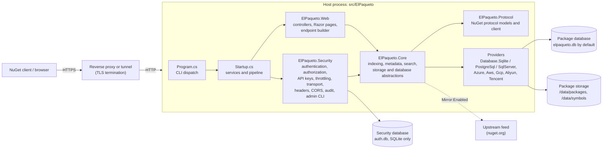
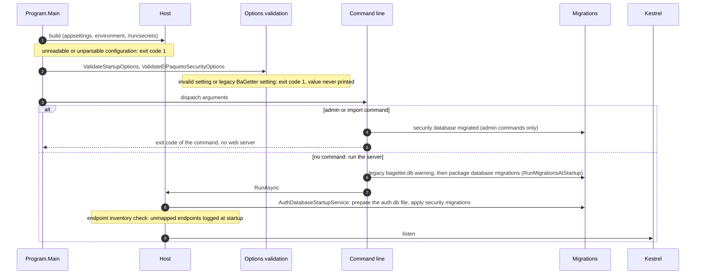

# Architecture

ElPaqueto is BaGetter with a security module added in front of it. The inherited projects keep their structure, renamed by [ADR 0001](../adr/0001-project-identity-and-rebranding-scope.md), and change as little as possible so that upstream fixes stay portable ([upstream touch map](upstream-touch-map.md)). Everything new lives in `src/ElPaqueto.Security` and is wired in by a few calls from the host ([ADR 0002](../adr/0002-authentication-architecture.md)).

## Components

| Component | Path | Origin |
| --- | --- | --- |
| Host | `src/ElPaqueto` | Inherited; `Program.cs`, `Startup.cs` and `ConfigureElPaquetoServer.cs` changed. |
| Web | `src/ElPaqueto.Web` | Inherited; controllers unchanged, a safe Markdown renderer added, branding in the layout and pages. |
| Core, Protocol | `src/ElPaqueto.Core`, `src/ElPaqueto.Protocol` | Inherited, unchanged apart from the rename and the target framework. |
| Providers | `src/ElPaqueto.Database.*`, `src/ElPaqueto.Azure`, `Aws`, `Gcp`, `Aliyun`, `Tencent` | Inherited. `ElPaqueto.Database.MySql` stays in the tree but is excluded from the build. |
| Security module | `src/ElPaqueto.Security` | New. Strict build baseline (`eng/ElPaqueto.Build.props`): nullable, warnings as errors, analyzers. |

## Module boundaries

- `ElPaqueto.Security` depends on `ElPaqueto.Core` and the ASP.NET Core shared framework only, never on `ElPaqueto.Web` or a database provider. `ModuleBoundaryTests` checks the project graph and the referenced assemblies.
- The security database has its own `AuthDbContext` and its own migrations, independent of the four package database providers. It never implements the inherited `IContext`, so the inherited migration runner and health checks never touch it ([security database](security-database.md)).
- The inherited controllers are not changed. They keep naming the scheme `NugetBasicAuthentication` and the policy `NuGetUserPolicy`; the security module registers its own handler and requirement under those names ([authentication](authentication.md), [authorization](authorization.md)).

## Registration entry points

The host calls into the security module from three places:

| Where | Call | Effect |
| --- | --- | --- |
| `Startup.ConfigureElPaquetoApplication` | `app.AddElPaquetoSecurity()` | Options and their validation, the security database and its migrator, password and API key services, the authentication handler, the authorization policies and permission table, throttling, CORS, forwarded headers, security headers, audit logging, and the replacement of the inherited API key check used by the write controllers. |
| `Startup.Configure` | `UseElPaquetoSecurityHeaders`, `UseElPaquetoForwardedHeaders`, `UseElPaquetoCors` | The middleware described in [request pipeline](request-pipeline.md). Authentication and authorization use the standard `UseAuthentication` and `UseAuthorization`. |
| `Program` | `ValidateElPaquetoSecurityOptions`, `AddElPaquetoCommands`, `ConfigureElPaquetoCommandLogging` | Startup validation, the `admin` commands, and logging to standard error for commands. |

Health checks are mapped as real endpoints by `MapElPaquetoHealthChecks`, so that endpoint authorization applies to them.

## Startup sequence

- The host is built inside a `try` in `Program.Main`: a configuration file that cannot be read stops the process with `ElPaqueto could not load its configuration`, and any unhandled error ends with exit code 1 instead of a crash (no core dump of process memory).
- The security database is prepared by a hosted service before the server listens: if it cannot be created or migrated, the server does not start.
- Startup warnings (HTTPS not required, `Security:PublicBaseUrl` missing, unmapped endpoints, `Development` environment) are audit events 1901 to 1906 ([audit logging](audit-logging.md)).

## Data

| Store | Content | Provider |
| --- | --- | --- |
| Package database | Package metadata, versions, dependencies, download counts | `Database:Type`: SQLite by default, PostgreSQL, SQL Server, Azure Table |
| Package storage | `.nupkg`, `.nuspec`, readme, icon and symbol files | `Storage:Type`: file system by default, or a cloud provider |
| Security database | Users, permissions, API key hashes | SQLite only ([data model](data-model.md)) |

There is no foreign key or transaction between the package database and the security database.
