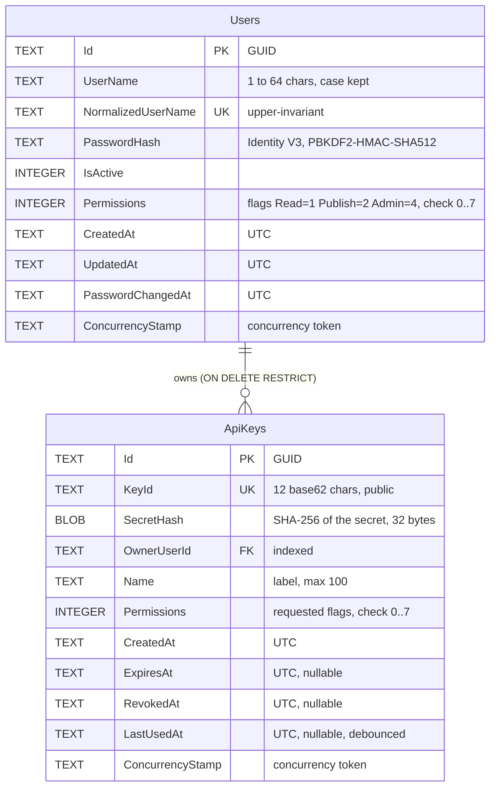

# Data model

ElPaqueto keeps users, permissions and API keys in its own SQLite database, separate from the inherited package database ([ADR 0002](../adr/0002-authentication-architecture.md)). This page is an overview; the column-level reference is in [security database](security-database.md) (`Users`) and [API keys](api-keys.md#storage) (`ApiKeys`), next to the reasons for each constraint.

## Rules

- **Nothing reversible is stored.** Passwords are stored as salted PBKDF2 hashes; API keys as the SHA-256 of their 256-bit secret. The complete key is shown once, by the `admin key` command that creates it ([secrets handling](secrets-handling.md)).
- **Effective permissions are computed, not stored.** A key's permissions are intersected with its owner's current permissions on every request; a disabled owner disables every key.
- **No deletion.** Users are disabled, keys are revoked; `ON DELETE RESTRICT` keeps keys from being orphaned if a user row were ever deleted.
- **Concurrency.** `ConcurrencyStamp` is regenerated on every update; the `admin` commands that check an invariant (last active administrator, single bootstrap) run the check and the change in one write transaction.
- **Dates** are UTC `DateTime` values stored as text, because SQLite cannot order `DateTimeOffset` values.
- **No link to the package database**: no foreign key, no shared transaction. Package ownership is not modelled.

## Storage settings

- File: `Security:Database:ConnectionString` (`Data Source=auth.db`; `/data/db/auth.db` in the image). Created with mode `0600` in a `0700` folder on Unix; in-memory databases and `file:` URIs are refused.
- Every connection sets `journal_mode = WAL` and a busy timeout (30 seconds by default), so the server and an `admin` command can work at the same time.
- Migrations: `src/ElPaqueto.Security/Data/Migrations/`, history table `__AuthMigrationsHistory`, applied at startup by the server and by the `admin` commands.

Details and the migration procedure: [security database](security-database.md).
