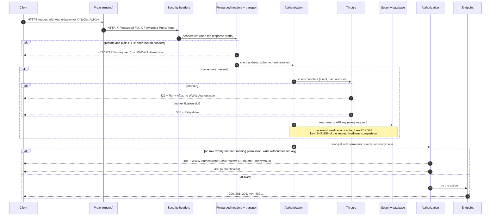

# Request pipeline

This page follows a request through the middleware as configured in `src/ElPaqueto/Startup.cs` (`Startup.Configure`). Each step links to the page that describes it in detail.

## Order

| # | Middleware | Registered by | What it does |
| --- | --- | --- | --- |
| 0 | Developer exception page, status code pages | `Startup.Configure`, `Development` environment only | Never enabled in `Production`: the developer page shows request headers, credentials included. |
| 1 | `SecurityHeadersMiddleware` | `UseElPaquetoSecurityHeaders` | Registers a callback that sets `X-Content-Type-Options`, `Referrer-Policy`, `X-Frame-Options`, the content security policy, `Cache-Control: no-store` on pages and errors, and HSTS when enabled, on **every** response including refusals ([web security](web-security.md)). |
| 2 | Forwarded headers | `UseElPaquetoForwardedHeaders` | Applies `X-Forwarded-For`, `X-Forwarded-Proto` and (without `Security:PublicBaseUrl`) `X-Forwarded-Host` only from trusted proxies, then applies `Security:PublicBaseUrl` ([forwarded headers](forwarded-headers.md)). |
| 3 | `TransportSecurityMiddleware` | `UseElPaquetoForwardedHeaders` | Refuses a remote plain-HTTP request with `403 HTTPS is required.` before any credential is read, when `Security:Transport:RequireHttps` is on. |
| 4 | Path base | `UsePathBase(PathBase)` | Strips the configured prefix. |
| 5 | Static files | `UseStaticFiles` | Serves `/_content/ElPaqueto.Web/...` (CSS, scripts, images) anonymously. |
| 6 | Authentication | `UseAuthentication` | Runs `ElPaquetoAuthenticationHandler` for requests that carry credentials: API key or Basic password, with throttling before any verification ([authentication](authentication.md), [throttling](throttling.md)). |
| 7 | Routing | `UseRouting` | Selects the endpoint. |
| 8 | CORS | `UseElPaquetoCors` | Answers preflight requests before authorization; adds CORS headers only for configured origins, never with credentials. |
| 9 | Authorization | `UseAuthorization` | `EndpointPermissionRequirement` behind the fallback, default and `NuGetUserPolicy` policies: the permission table decides ([authorization](authorization.md)). |
| 10 | `OperationCancelledMiddleware` | `UseOperationCancelledMiddleware` | Inherited: a request aborted by the client ends quietly. |
| 11 | Endpoints | `ElPaquetoEndpointBuilder.MapEndpoints`, `MapElPaquetoHealthChecks` | Controllers, Razor pages and the health endpoints. The write controllers still call the inherited `IAuthenticationService`, replaced by a check that only confirms the authorization decision ([API keys](api-keys.md#the-inline-check-of-the-inherited-write-actions)). |

## A request

## Answers

| Status | Produced by | When | Body and headers |
| --- | --- | --- | --- |
| `403` | Transport middleware | Remote plain HTTP while HTTPS is required | `HTTPS is required.`, no `WWW-Authenticate`, never a redirect |
| `401` | Authorization, with the authentication challenge | No credentials, or credentials that failed for any reason | Empty, `WWW-Authenticate: Basic realm="ElPaqueto"`, identical for every failure reason |
| `403` | Authorization | Authenticated but denied: missing permission, unmapped endpoint, method not in the row, write without a key in `X-NuGet-ApiKey` | Empty, no challenge |
| `429` | Authentication handler (throttle) | Too many recent failures for the client, the network, the pair or the account | `Retry-After`, no challenge; the credentials are not checked |
| `503` | Authentication handler (throttle) | No password verification slot free within the queue limit | `Retry-After` (`Security:Throttling:BusyRetryAfter`) |
| `500` | Authentication handler | The security database cannot be read for a request that carries credentials | Empty; the exception is logged. Requests without credentials are not affected |
| `204` | CORS | Preflight request | `Access-Control-Allow-*` only for an allowed origin, method and headers |

The anonymous liveness endpoint (`HealthCheck:Path`, `/health`) and static files are the only resources served without credentials. Every decision of steps 3, 6 and 9 is an audit event ([audit logging](audit-logging.md)).

## Where a request touches the database

- No credentials: the security database is not opened.
- Basic password: one indexed read of the user, on every request, so that a disabled user, a permission change or a password reset applies to the next request. The password hash is only recomputed on a cache miss.
- API key: one indexed read of the key and its owner, on every request; the last-use timestamp is written at most once per `Security:ApiKeys:LastUsedUpdateInterval`.
- The authorization handler never queries a database: it reads the claims built by authentication in the same request.
