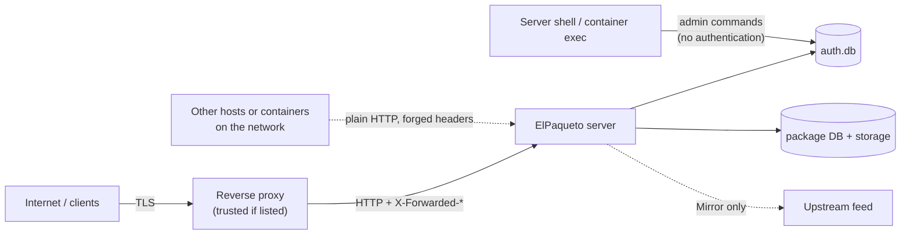

# Threat model

The threats ElPaqueto is designed against, the mitigations as built, and the evidence for each: a test, or an explicit residual risk. The design decisions are in [ADR 0002](../adr/0002-authentication-architecture.md); this page describes the system at the time of writing and is updated with it.

Test references name the test class and method (`Class.Method`). Integration tests are in `tests/ElPaqueto.Tests`, unit and process tests in `tests/ElPaqueto.Security.Tests`, the container checks in `eng/docker/smoke-test.sh`.

## Assets

| Asset | Why it matters |
| --- | --- |
| Packages and symbols | Integrity: a replaced or injected package runs in every build that restores it. Confidentiality: private code. |
| Credentials | User passwords and API keys give access to the feed and the right to publish. |
| Security database (`auth.db`) | Password and API key hashes, users and permissions. |
| Package database and storage | Metadata and files; their loss is loss of the feed. |
| Availability | Builds fail when the feed is down or throttles legitimate clients. |
| Audit trail | Needed to detect and investigate misuse. |

## Actors

| Actor | Capabilities assumed |
| --- | --- |
| Anonymous Internet client | Reaches the reverse proxy; sends any request, any header, from many addresses. |
| Authenticated reader | Holds a password or key with `Read`. |
| Publisher | Holds a key with `Publish`. |
| Administrator | Shell access to the server, or `Admin` permission. |
| Malicious client next to the server | On the same network as the server (another container, a host on a shared private network); can reach port 8080 directly and forge forwarded headers. |
| Compromised CI pipeline | Has the keys given to that pipeline. |

## Trust boundaries

1. Client to proxy: TLS, terminated by the proxy.
2. Proxy to server: only listed proxies are trusted for `X-Forwarded-*`; everyone else is a direct client.
3. Server to data: file system and database permissions; the security database is owner-only.
4. Shell to data: whoever runs the `admin` commands with the data is an administrator, by design.
5. Server to upstream: outbound, only with `Mirror:Enabled`.

## STRIDE

| # | Threat | Mitigation | Evidence |
| --- | --- | --- | --- |
| S1 | Anonymous access to packages or writes | Deny by default: fallback policy, every endpoint needs a row of the permission table; only `/health` and static files are anonymous | `AuthorizationIntegrationTests.Anonymous_IsAnsweredWith401OnEveryRoute`, `BasicAuthenticationIntegrationTests.WithNoUserAtAll_EveryProtectedEndpointReturns401` |
| S2 | Password guessing | PBKDF2 (210000 iterations), 15-character minimum, throttling per client, /48 network, (user, client) pair and account; identical answers for unknown, disabled and wrong; a repeated identical attempt counts once, every distinct one counts, fail closed when the fingerprint store is full | `ThrottlingIntegrationTests.AfterFiveWrongPasswords_TheRightPasswordGets429WithoutVerification_OtherClientsAreUnaffected_AndTheThrottleExpires`, `LoginThrottleTests.DistinctWrongPasswords_StillTripThePairAtItsLimit_WhateverIsRepeatedInBetween`, `LoginThrottleTests.WhenTheFingerprintStoreIsFull_NewFailuresAreCountedEveryTime`, `ThrottledClientTests.DistinctWrongPasswords_StillTripTheDefaultThrottle_AndTheClientThenReports429WithoutWaiting`, `ThrottlingIntegrationTests.ThirtyFailuresAcrossUserNames_ThrottleTheClientEvenForAValidAccount`, `PasswordServiceTests.Validate_RejectsAPasswordThatIsTooShort` |
| S3 | User enumeration | Same 401 bytes for every failure; same hashing work for unknown and disabled users; throttle answers independent of existence | `BasicAuthenticationIntegrationTests.WrongPasswordUnknownUserAndDisabledUser_GetByteIdenticalResponses`, `PasswordServiceTests.Verify_ForAKnownUser_PerformsTheSameNumberOfVerificationsAsForAnUnknownOne`, `ThrottlingIntegrationTests.KnownAndUnknownUserNames_GetIdenticalAnswersAtEveryStep` |
| S4 | Guessing or forging API keys | 256-bit secrets, fixed-time comparison, same work for unknown key ids, key failures counted by the throttle | `ApiKeyServiceTests.Validate_AnUnknownKeyId_Fails_AfterTheSameComparisonWork`, `ApiKeyServiceTests.EveryValidationThatReachesTheDatabase_GoesThroughTheConstantTimeComparer`, `ApiKeyThrottlingIntegrationTests.AfterTheClientLimit_TheRightKeyGets429WithoutValidation_AndOtherClientsAreUnaffected` |
| S5 | Use of a revoked, expired or orphaned key | State read on every request, no cache; effective permissions = key ∩ owner's current permissions | `ApiKeyServiceTests.Validate_ARevokedKey_Fails`, `ApiKeyServiceTests.Validate_AnExpiredKey_FailsFromTheExpiryInstantOn`, `ApiKeyServiceTests.DemotingTheOwner_RemovesThePermissionFromTheKeyAtTheNextUse_WithoutTouchingTheKey`, smoke test "revoked Publish key pushing a package" |
| S6 | A key used to impersonate another user via the Basic user name | The user name sent with a key is ignored; a token-shaped password is only ever validated as a key | `ApiKeyAuthenticationIntegrationTests.TheUserNameNeverSelectsAnotherUser` |
| S7 | Spoofing the client address or scheme with forwarded headers | Headers applied only from listed proxies (loopback by default); networks covering everything rejected | `ProxyAndTransportIntegrationTests.UntrustedRemote_SpoofedProtoAndHost_IsTreatedAsPlainHttpAndRejected`, `ProxyAndTransportIntegrationTests.UntrustedRemote_SpoofedLoopbackForwardedFor_IsNotTreatedAsLoopback`, `ThrottlingIntegrationTests.ASpoofedForwardedForFromAnUntrustedClient_DoesNotChangeTheThrottledAddress` |
| S8 | Host header poisoning of service index URLs | `Security:PublicBaseUrl` pins every generated URL | `ProxyAndTransportIntegrationTests.PublicBaseUrl_PinsEveryGeneratedUrl`, `ProxyAndTransportIntegrationTests.UntrustedRemote_OverHttps_SpoofedHostIsIgnored` |
| T1 | Publishing or replacing packages without permission | Write rows need `Publish` from a key in `X-NuGet-ApiKey`; passwords and Basic-sent keys are refused for writes; hard delete also needs `Admin` | `AuthorizationIntegrationTests.APasswordWithPublish_NeverOpensAWriteRoute`, `AuthorizationIntegrationTests.APublishKeySentAsBasicPassword_NeverOpensAWriteRoute`, `ApiKeyAuthenticationIntegrationTests.APublishKeyOfAnOwnerWhoLostPublish_CannotPush` |
| T2 | State change through a read route or an unexpected method | Each row lists its methods; read routes refuse state-changing methods | `AuthorizationIntegrationTests.EveryReadRoute_RefusesEveryMethodThatChangesState`, `AuthorizationIntegrationTests.AMethodTheRouteDoesNotAccept_IsRefusedBeforeTheAction` |
| T3 | A new or ported route left unprotected | Unmapped endpoints are denied and logged at startup; inventory tests keep the table and the endpoints in step | `AuthorizationIntegrationTests.EveryMatchableEndpoint_HasARowInThePermissionTable`, `AuthorizationIntegrationTests.EveryRowOfThePermissionTable_MatchesARealEndpoint`, `AuthorizationIntegrationTests.EveryRouteNameOfTheWebProject_HasARowAndNoRowIsInvented` |
| T4 | Script injection through package metadata in the web UI | Markdown rendered with HTML disabled and unsafe URLs removed; content security policy | `WebUiIntegrationTests.PackagePage_RendersReadmeAndReleaseNotes_WithoutAnythingExecutable`, `SecurityHeadersIntegrationTests.EveryPage_HasTheHtmlPolicyFrameProtectionAndNoStore` |
| T5 | Cross-site use of a browser's remembered credentials | No CORS by default, never credentials mode, exact origins; `X-Frame-Options: DENY` | `CorsIntegrationTests.ByDefault_APreflightGetsNoApproval`, `CorsIntegrationTests.AnAllowedOrigin_CanReadAnAuthenticatedResponse_WithoutCredentialsMode` |
| T6 | Race on administrator invariants | Bootstrap and last-administrator checks in one write transaction | `BootstrapCommandTests.TwoConcurrentBootstraps_ExactlyOneSucceeds`, `UserCommandTests.TwoConcurrentDisables_OfTheOnlyTwoActiveAdministrators_LeaveOneActive` |
| R1 | Denied or abusive actions without a trace | Audit events for every authentication, authorization, transport, throttling and administration decision | `AuditLoggingIntegrationTests.EveryDecision_IsAudited_AndNoLogEntryContainsACredential` |
| I1 | Credentials sent over plain HTTP | Remote plain HTTP refused before reading credentials, no challenge, no redirect | `ProxyAndTransportIntegrationTests.DefaultTrustedLoopbackProxy_RelayingRemotePlainHttp_IsRejected`, `SecurityHeadersIntegrationTests.HttpsRequiredRefusal_HasTheBaseHeaders`, smoke test "remote plain HTTP is refused with 403 and no challenge" |
| I2 | Secrets in logs or error output | Fixed failure messages, redaction rules, no request logging, configuration values never printed | `AuditLoggingIntegrationTests.EveryDecision_IsAudited_AndNoLogEntryContainsACredential`, `LoggingGuardTests.TheServerSources_NeverEnableRequestLoggingOrSensitiveDataLogging`, `LegacyAuthenticationSettingsTests.LegacySetting_FailsValidation_NamingThePathButNotTheValue`, `BootstrapCommandTests.ThePasswordAndItsHash_NeverAppearInAnyOutputOrLog` |
| I3 | Theft of `auth.db` or a backup | Hashes only (PBKDF2, SHA-256 of 256-bit secrets); owner-only file and folder | `ApiKeyServiceTests.TheDatabaseFiles_NeverContainTheSecretOrTheToken`, `AuthDatabaseFileTests.Prepare_OnUnix_RestrictsTheDirectoryAndTheFileToTheOwner`, smoke test "/data/db/auth.db exists, mode 600" |
| I4 | Passwords visible in process arguments or shell history | The `admin` commands refuse password arguments | `BootstrapCommandTests.APasswordOption_IsRejectedWithCode2AndTheValueIsNotEchoed`, `UserCommandTests.PasswordsOnTheCommandLine_AreRejectedWithCode2AndNotEchoed` |
| I5 | Configuration disclosure | `/health` returns the overall status only; details need `Admin`; the statistics page lists no services by default | `AuthorizationIntegrationTests.HealthDetails_NeedAdmin`, `WebUiIntegrationTests.StatisticsPage_DoesNotListTheConfiguredServices_WithTheShippedSettings` |
| I6 | An open feed after an upgrade from BaGetter | Legacy `ApiKey` and `Authentication` settings stop the server | `LegacyAuthenticationSettingsTests.LegacySettingsInSecretFiles_AreDetected`, `LegacyAuthenticationSettingsTests.LegacySetting_FailsValidation_NamingThePathButNotTheValue` |
| D1 | Exhausting the CPU with password hashing | Throttle before hashing; bounded concurrent verifications and queue; 503 beyond; a repeated identical password is answered without hashing | `ThrottlingIntegrationTests.WhenVerificationCapacityIsExhausted_TheAnswerIs503WithRetryAfter`, `ThrottlingIntegrationTests.AClientRetryingAStalePassword_IsVerifiedAndCountedOnce_AndTheRightPasswordWorksRightAfter` |
| D2 | Exhausting memory with throttle counters | Bounded counters per kind and bounded failed-attempt fingerprints (`MaxTrackedEntries`) | `LoginThrottleTests.AMillionDistinctUserNames_KeepEveryCounterKindWithinItsBound`, `LoginThrottleTests.AFloodOfDistinctAttempts_KeepsTheFingerprintStoreWithinItsBound`, `LoginThrottleTests.AFloodOfNewCounters_EvictsNeitherATrippedCounterNorOneInFlight` |
| D3 | Unauthenticated requests triggering upstream traffic (mirror) | Authorization runs before the page or the mirror is reached | `WebUiIntegrationTests.AnonymousPackagePage_WithMirrorEnabled_MakesNoUpstreamRequest` |
| E1 | A key granting more than its owner | Creation requires the owner to hold every permission; effective permissions recomputed per request | `ApiKeyServiceTests.Create_AnAdminKey_RequiresAnAdminOwner`, `ApiKeyServiceTests.Create_WithAPermissionTheOwnerLacks_Fails` |
| E2 | Permissions implied by another | `Read`, `Publish` and `Admin` are independent | `AuthorizationIntegrationTests.PublishPermission_DoesNotImplyRead`, `AuthorizationIntegrationTests.AdminPermission_ImpliesNeitherReadNorPublish` |
| E3 | Container escape or tampering with the application | Non-root UID 1654, read-only root filesystem supported, no capabilities, application files owned by root | smoke test "runs as UID", "the root filesystem is read-only", "the application folder is not writable by the process" |

## Residual risks

Accepted for this version, with the reason. Each is also listed in the user-facing [known limitations](../user/known-limitations.md).

| Risk | Why it remains | What reduces it |
| --- | --- | --- |
| **Throttling is per process, in memory.** Restarting resets the counters; several instances do not share them. | Single-node design; a shared store would add infrastructure. | Run one instance; add rate limits at the proxy; strong passwords and keys. |
| **Clients behind one NAT share a budget**; an attacker with many addresses gets one guess per address and throttle period. | Inherent to address-based throttling. | Account-level counters; password cost and policy; prefer API keys. |
| **Basic credentials are cached by clients**: NuGet configurations, credential stores and browsers keep them. | HTTP Basic is what stock NuGet clients support. | API keys with expiry and per-machine revocation; `Read`-only keys for restore. |
| **No web login, session or logout.** The browser keeps the credentials until it closes. | Out of scope for V1 (ADR 0002). | Use a separate browser profile on shared machines. |
| **`Read` sees every package.** No per-package or per-feed permissions. | V1 permission model (ADR 0002). | Run separate servers for separate audiences. |
| **`Publish` can overwrite or remove versions** when `AllowPackageOverwrites` or retention options are enabled. | Server-wide settings inherited from BaGetter. | Keep the defaults (`AllowPackageOverwrites: false`, no retention). |
| **The `admin` commands do not authenticate.** | Shell access to the server already gives access to the data. | Restrict shell, `docker exec` and volume access; audit events 2001 to 2012. |
| **SQLite is single-writer.** | Simplicity; writes are rare (administration, last-use timestamps). | WAL and a busy timeout; debounced last-use writes. |
| **Mirror mode makes outbound requests** with the server's identity and `Mirror:Authentication`. | Feature inherited from BaGetter, off by default. | Leave `Mirror:Enabled` off, or allow only the upstream host in egress rules. |
| **TLS is terminated outside ElPaqueto.** A misconfigured proxy, or traffic between the proxy and the server on a hostile network, is outside its control. | Recommended deployment model. | Keep the proxy on the same host or a private network; list only that proxy as trusted. |
| **Symbols need Basic credentials**, which some debuggers may not send. | Symbols are as private as packages. | Not verified with debuggers; see [known limitations](../user/known-limitations.md). |
| **Libraries' exception messages** (for example database providers) are logged as they are. | Outside ElPaqueto's control. | Connection strings are never logged by ElPaqueto; review logs before sharing them. |
