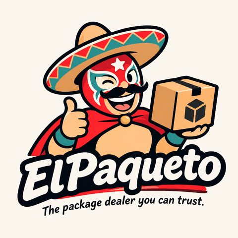

<p align="center">
  
</p>

# ElPaqueto: the package dealer you can trust

[](https://github.com/sputier/ElPaqueto/actions/workflows/ci.yml)
[](https://github.com/sputier/ElPaqueto/actions/workflows/docker.yml)

ElPaqueto is a private, self-hosted [NuGet] server with built-in authentication. It is based on [BaGetter] and keeps its package storage, its protocol support and its web UI, and adds users, permissions and API keys in front of every route.

## Why

- **Deny by default.** Every route needs credentials, except the liveness endpoint and static files. A route that is not in the permission table is refused.
- **Users with `Read`, `Publish` and `Admin` permissions**, stored with salted PBKDF2 password hashes. No default account and no default password.
- **Per-user API keys** that can be scoped, given an expiry, rotated and revoked at once. Publishing needs a key; restore can use a key or a password.
- **Stock NuGet clients.** HTTP Basic authentication and the `X-NuGet-ApiKey` header, as `dotnet nuget` already sends them. No plugin and no credential provider.
- **No extra infrastructure.** No external identity provider: users and keys live in a separate SQLite database next to the packages, managed with command-line `admin` commands.
- **Hardened by default**: HTTPS required for remote clients, trusted reverse proxies listed explicitly, sign-in throttling, security headers, an audit trail that never logs a secret, and a non-root container image built to run with a read-only root filesystem.

## Status

ElPaqueto has **no release yet** (version `0.1.0-prerelease`) and no published container image: build it from this repository. The authentication, authorization, API key, transport and throttling features are implemented and tested; the end-to-end validation of clients and platforms is still in progress. Read the [known limitations](docs/user/known-limitations.md) before you deploy it.

## Quick start (Docker, local evaluation)

These commands run the server on your machine only, over plain HTTP. They need Docker, the .NET SDK and a Bash-compatible shell.

```bash
# 1. Build the image and start the server, reachable from this machine only.
docker build -t elpaqueto:local .
docker volume create elpaqueto-data
docker run -d --name elpaqueto \
  --read-only --tmpfs /tmp --cap-drop ALL --security-opt no-new-privileges \
  -v elpaqueto-data:/data -p 127.0.0.1:8080:8080 \
  -e Security__Transport__RequireHttps=false \
  elpaqueto:local

# 2. Create the first administrator, then a user who publishes. Each password is prompted for.
docker exec -it elpaqueto dotnet ElPaqueto.dll admin bootstrap --username admin
docker exec -it elpaqueto dotnet ElPaqueto.dll admin user create alice --permissions publisher

# 3. Create an API key for alice. It is printed once: here, into a file only you can read.
(umask 077 && docker exec elpaqueto dotnet ElPaqueto.dll admin key create \
  --user alice --name laptop --permissions read,publish --expires 30d > elpaqueto.key)

# 4. In your solution folder: add the source, give it the key, push and restore.
#    (Skip "dotnet new nugetconfig" if the folder already has a NuGet.Config.)
dotnet new nugetconfig
dotnet nuget add source http://localhost:8080/v3/index.json --name elpaqueto --allow-insecure-connections
export NuGetPackageSourceCredentials_elpaqueto="Username=apikey;Password=$(cat elpaqueto.key)"
dotnet nuget push <package>.nupkg --source elpaqueto --api-key "$(cat elpaqueto.key)"
dotnet restore
```

`Security__Transport__RequireHttps=false` and `--allow-insecure-connections` are for this loopback evaluation only: the key travels in clear on every request. Remove both before anyone else can reach the server. The web UI is at <http://localhost:8080/>; the browser asks for alice's user name and password.

## Production

HTTPS is required. Run the container behind a TLS-terminating reverse proxy or tunnel, tell ElPaqueto which proxy to trust and the public URL of the feed, and keep the default `Security:Transport:RequireHttps=true`:

- [Installation](docs/user/installation.md) and [Docker](docs/user/docker.md): hardening flags, volumes, health check, secrets;
- [`docker-compose.example.yml`](docker-compose.example.yml): a Compose deployment behind a proxy;
- [Running behind a reverse proxy or tunnel](docs/user/reverse-proxy.md): nginx, Caddy, Traefik and tunnel examples;
- [Backup and restore](docs/user/backup.md) and [upgrading](docs/user/upgrading.md).

Already running BaGetter? Read [Upgrading from BaGetter](docs/user/upgrading-from-bagetter.md) first: BaGetter's `ApiKey` and `Authentication` settings stop ElPaqueto at startup, and users and keys must be created again.

## Documentation

- [User documentation](docs/user/README.md): installation, configuration, administration, client setup, publishing, troubleshooting.
- [Technical documentation](docs/technical/README.md): architecture, request pipeline, security design, threat model, testing.
- [Architecture decision records](docs/adr/README.md).
- [Documentation index](docs/readme.md).

The inherited BaGetter documentation site under `docs/docs/` is not maintained for ElPaqueto yet: prefer the pages above.

## Building from source

Building needs the **.NET 10 SDK** (the exact version is pinned in `global.json`):

```bash
dotnet build ElPaqueto.sln
dotnet test ElPaqueto.sln
```

See [CONTRIBUTING.md](CONTRIBUTING.md) for running the server from source and for the rules of a pull request.

## Origin and license

ElPaqueto is a fork of [BaGetter] (MIT), itself a fork of [BaGet] (MIT). ElPaqueto:

- renamed every project, namespace, assembly and default name from BaGetter to ElPaqueto ([ADR 0001](docs/adr/0001-project-identity-and-rebranding-scope.md));
- replaced BaGetter's optional shared API key and plain-text credentials with users, permissions and API keys stored hashed in a dedicated security database, and made every route deny by default ([ADR 0002](docs/adr/0002-authentication-architecture.md));
- added the transport, proxy, throttling, header and audit-logging protections described in the [technical documentation](docs/technical/README.md), and a hardened container image.

Upstream changes are ported as described in [Porting upstream changes](docs/upstream-porting.md). BaGetter and BaGet are not affiliated with ElPaqueto and do not endorse it.

The source code is licensed under the [MIT License](LICENSE); the upstream copyright notices are kept there. Third-party components are listed in [THIRD-PARTY-NOTICES.md](THIRD-PARTY-NOTICES.md). The ElPaqueto logo is **not** covered by a stated licence yet: see [assets/branding](assets/branding/README.md).

## Contributing and security

Contributions are welcome: read [CONTRIBUTING.md](CONTRIBUTING.md) first.

Report vulnerabilities privately, as described in the [security policy](SECURITY.md). Never in a public issue, pull request or discussion.

[NuGet]: https://learn.microsoft.com/nuget/what-is-nuget
[BaGetter]: https://github.com/bagetter/BaGetter
[BaGet]: https://github.com/loic-sharma/BaGet
